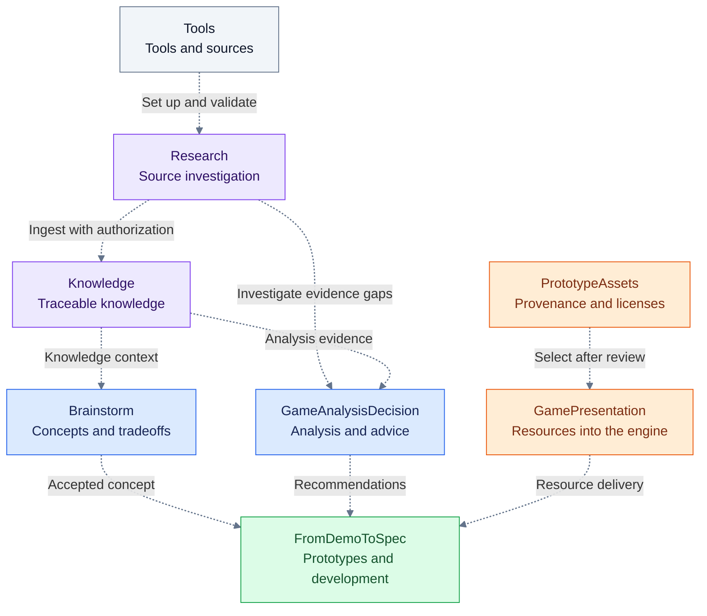
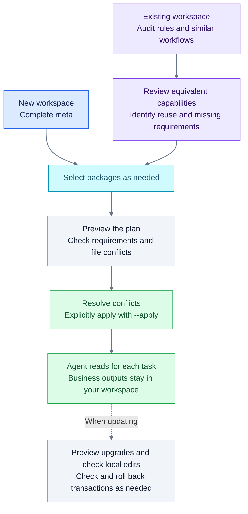

# AgentWorkSpace

[简体中文](README.md) | **English**

**Set up a lasting workspace for AI agents, or extend an existing project: keep your rules and add the collaboration methods, skills and modules you need.**

An ongoing project often means repeating rules, organizing context, choosing methods and leaving useful outputs for the next task. AgentWorkSpace packages these practices as installable, upgradable files and tools that an agent reads and uses when the task calls for them.

- **Existing workspace**: audit current needs, reuse reviewed capabilities and install selected modules and missing dependencies.
- **New workspace**: install the complete collaboration framework, then choose brainstorming, knowledge management, travel planning or game-development modules.
- **A few skills**: use the Skills package on its own and install by name, without adopting the complete framework.

A released version is available to try, and public examples are still being developed. **There is no complete public end-to-end case study or demo video yet.** The capabilities and commands below describe what is available; engineering checks do not establish long-term benefits, creative quality or game experience. Game development currently has broader module coverage, while the collaboration framework and skills also support other tasks.

[New workspace](#get-started) · [Existing workspace](#existing-workspace-audit-before-adding-capabilities) · [Choose modules](#use-the-workspace) · [Licensing](#licensing-and-content-boundaries)

Give the repository path and target workspace path to an agent that can read/write files and run commands. For example:

> Read the distribution README and relevant package guides. My target workspace is … and I need brainstorming and prototype development. Audit and reuse existing rules if present; otherwise set up a new workspace. Show the installation plan, then apply changes that have no conflicts.

There is one complete meta edition. New workspaces install it by default; existing workspaces can use compatible mode to reuse their framework and add only selected packages and missing capabilities. The agent reads rules and methods as each task requires, without running every workflow on every task.

## How packages support each other

A task can draw on other packages when it needs them: research adds sources, the knowledge base supplies existing material, analysis supports decisions, and presentation and assets feed into the project. This game-development example shows the main optional relationships.



**Dotted arrows show optional collaboration, not installation dependencies or an automatic pipeline.** The agent reads relevant entrypoints for the current problem, checks interfaces, tools and authority, then returns results to their owning project. Tools registers optional entrypoints; business integration still requires validation in the recipient's environment. Analysis recommendations and engineering checks do not replace real playtesting.

Meta or a reviewed existing framework supplies collaboration rules. **Skills provides selected methods** for debugging, testing, research and writing. **Travel provides its own trip research, daily planning and private offline website workflow**, without requiring the game-development combination above.

| What you want to do | How packages can work together | What you keep |
|---|---|---|
| Turn a game idea into a prototype | Explore and narrow concepts with Brainstorm, then develop with FromDemoToSpec; use Knowledge or GameAnalysisDecision for gaps in a decision, and return playtest questions to analysis or brainstorming | Concept and scope, a playable prototype, verification and playtest feedback |
| Investigate a reference mechanism or development tool | Research checks sources; select REA in Tools when artifact evidence is necessary; send useful material to Knowledge with authorization | Sources, applicability limits and the actual effect on a project judgment |
| Add presentation and assets to a game | GamePresentation defines purposes and prepares or selects resources; PrototypeAssets can supply assets with provenance and license records | In-project resources and licenses, delivery and recovery records |
| Plan a trip | Use Travel alone, configuring collection or browser checks as needed | Trip plans, research and a private offline website outside the package |

These are usage examples, not completed public case studies or a fixed sequence that every task must follow.

<details>
<summary>Expand: installation, upgrades and recovery</summary>



Capability review and task execution are the agent's work within its authority. The installer discovers candidates, plans differences and applies file changes; it does not merge business workflows or enable accounts or scheduled tasks. Package rollback covers managed files only. Restore external tool runtimes and client settings separately according to each package's guide.

</details>

## Get started

Clone or download this repository into a separate directory from the user workspace. The root installer and skill picker need Python 3.10+. GameAnalysisDecision, GamePresentation, PrototypeAssets and Travel tools need Node.js 22+. Brainstorm, FromDemoToSpec and some Knowledge tools also use PowerShell 7; the first Knowledge Ingest requires Git. Runtime verification for this release was performed on Windows; check each package before claiming other platform support.

Run these commands from the distribution directory. Preview before applying:

```text
python scripts/workspace.py doctor
python scripts/workspace.py init --target <workspace-path> --packages brainstorm fromdemotospec knowledge
python scripts/workspace.py init --target <workspace-path> --packages brainstorm fromdemotospec knowledge --apply
python scripts/workspace.py status --target <workspace-path>
```

In the default full mode above, you can omit `--packages` or select only the packages you need. Meta is always installed in that mode. Use `add` to add packages later and `upgrade` to update them. Commands preview changes by default; `--apply` writes them. Resolve any reported `conflicts` first.

## Existing workspace: audit before adding capabilities

If you already have collaboration rules, a knowledge base or other modules, tell the agent what you need now, such as “I only need brainstorming; audit my existing framework and recommend an integration plan.” Compatible mode lists reusable capabilities, optional recommendations and genuinely missing dependencies of selected packages. A reviewed equivalent provider removes the need to install meta. A matching file name alone does not establish compatibility.

The audit also covers overlap and integration boundaries between packages and existing modules/workflows. During selective installation, later additions or actual integration, the agent uses `package_review` to examine responsibilities, inputs/outputs, entrypoints, authority and data ownership. It explains whether compatibility work is needed and proposes a host-specific approach. Reuse without installation, coexistence and adaptation are options, not preset decisions. Satisfied dependencies and conflict-free files do not establish interoperability; unresolved plans do not trigger automatic merging or migration.

```text
python scripts/workspace.py audit --target <workspace-path> --needs brainstorm
python scripts/workspace.py audit --target <workspace-path> --packages brainstorm --profile <reviewed-profile.json>
python scripts/workspace.py init --target <workspace-path> --mode compatible --packages brainstorm --profile <reviewed-profile.json>
python scripts/workspace.py init --target <workspace-path> --mode compatible --packages brainstorm --profile <reviewed-profile.json> --apply
```

The agent reviews host rules and interfaces against the returned criteria, then records its reason, evidence paths and hashes in a profile. Changed evidence requires re-review. Supply missing capabilities through selected complete meta or a reviewed existing substitute. Compatible mode adds no unselected package: business packages go under `modules/<id>` and optional meta under `modules/meta`, preserving root rules and home documents. Ask the agent to read the generated `agent-workspace-compatibility.md`; automatic navigation and Skill discovery depend on the actual host platform. See the [compatible-mode guide](docs/compatible-workspace.md).

## Use the workspace

The distribution contains **one meta foundation and ten peer packages**. Meta provides collaboration rules and workspace structure; full mode installs it at the root, while compatible mode optionally installs it under `modules/meta`. State your goal, constraints and completion criteria to use it. Choose each package as needed; table order implies neither hierarchy nor installation priority. Brainstorm, FromDemoToSpec and Knowledge require host-governance capabilities, supplied by meta or a reviewed existing framework. Existing workspaces can reuse reviewed capabilities without adding packages for optional integrations.

[Meta guide](meta/README.md) · [Package dependencies and tool requirements](docs/package-dependencies.md)

| Package | Purpose and example task | Installed location | Standalone use and optional integration |
|---|---|---|---|
| [Brainstorm](packages/brainstorm/README.md) | “Help me explore this problem…”; create sessions as needed | `modules/brainstorm` | No other business package required; Knowledge and GameAnalysisDecision are optional |
| [FromDemoToSpec](packages/fromdemotospec/README.md) | “Build a playable prototype…”; develop in a separate project directory | `modules/fromdemotospec` | No other business package required; add knowledge, analysis, presentation and assets as needed |
| [Knowledge](packages/knowledge/README.md) | “Query the knowledge base” or “Ingest these sources”; an empty library can be queried | `modules/knowledge` | No other business package required; configure its scope and local Git before the first Ingest |
| [Skills](packages/skills/README.md) | 16 development, research, writing and workflow methods; install chosen names | `modules/skills` | No other module required; adding the library does not activate every skill |
| [GameAnalysisDecision](packages/game-analysis-decision/README.md) | Evidence-based game analysis, conditional recommendations and method correction | `modules/game-analysis-decision` | Works alone; Knowledge and other host packages are optional |
| [GamePresentation](packages/game-presentation/README.md) | Presentation specifications, resource preparation and Godot delivery/recovery | `modules/game-presentation` | Manual/generated sources work; PrototypeAssets is optional |
| [Travel](packages/travel/README.md) | “Research and plan this trip…”; generate a private offline website | `modules/travel` | Works alone; no required package, account service or server; browser verification is optional |
| [PrototypeAssets](packages/prototype-assets/README.md) | 119 assets with provenance/license records and verification/export tools | `modules/prototype-assets` | Runtime copies and licenses remain usable without their source package |
| [Research](packages/research/README.md) | Research Markdown, URLs and questions; game/source references and optional proactive exploration | `modules/research` | Works alone; Knowledge, MCP, media tools and host scheduling require separate setup/authority |
| [Tools](packages/tools/README.md) | Decision models, REA, image candidates, capture and source connections on demand | `modules/tools` | Works alone; set up runtime outside the package and validate business integration |

Follow a package name in the table for its quick start, task workflow, requirements and usage boundaries. Use `init` as shown above for installation. To add a package to an existing installation, preview with `add --packages <package-id>`, then apply with `--apply`.

Start tasks once the framework is installed; create business content when the task needs it. FromDemoToSpec provides a development workflow. The game project is created during a specific development task. Before the first Knowledge Ingest run, the agent must configure the real knowledge scope and establish a separate local Git baseline inside the module. Existing libraries keep their history. Do not use the outer repository as that baseline or create a remote or push automatically. The original setup wizard remains available for standalone customization; installation does not require another interview. Keep the registered module directory name unchanged.

Keep projects under `projects/` or a directory you choose. Sessions, knowledge content and personal configuration belong in your workspace, not in this distribution repository. `.agent-workspace/state.json` records installed versions and framework file baselines; it does not own your business records.

Meta also includes [Humanizer-zh](meta/workspace/.agents/skills/humanizer-zh/SKILL.md). Use it to edit Chinese prose for clarity while preserving facts, uncertainty and the author's voice. It is editing guidance, not an authorship detector. English documentation should preserve the same factual accuracy.

## Select skills as needed

Skills is one of the peer packages above. After adding it, choose the methods to install. Add any other package with `add --packages` as needed. The commands below are examples; select the packages and skills relevant to your task.

```text
python scripts/workspace.py audit --target <workspace-path> --needs skills
python scripts/workspace.py add --target <workspace-path> --packages skills
python scripts/workspace.py add --target <workspace-path> --packages skills --apply
python <workspace-path>/modules/skills/scripts/skills.py list
python <workspace-path>/modules/skills/scripts/skills.py install --target <workspace-path> --names systematic-debugging property-based-testing
python <workspace-path>/modules/skills/scripts/skills.py install --target <workspace-path> --names systematic-debugging property-based-testing --apply
```

Add --platform codebuddy for CodeBuddy selection. Skill updates and rollback use their own transactions and preserve conflicting user edits. Game-routing methods can use project facts and available tools without the optional packages. Engineering checks do not establish long-term method benefits or user acceptance of presentation quality.

## Compatibility, upgrades and recovery

See [catalog.json](catalog.json) for the current version and component inventories. Each release names its direct predecessor and provides compatibility notes, steps and recovery instructions in `upgrades/`. Published tags are immutable. Follow the declared release chain.

```text
python scripts/workspace.py upgrade --target <workspace-path>
python scripts/workspace.py upgrade --target <workspace-path> --apply
python scripts/workspace.py rollback --target <workspace-path> --transaction <transaction-id>
python scripts/workspace.py rollback --target <workspace-path> --transaction <transaction-id> --apply
```

Upgrades compare the saved baseline, local files and incoming content. If both local and upstream versions changed a file, the tool reports a conflict. If upstream did not change it, local edits or deletions remain. User data is preserved. Each application has transaction backups, and rollback also checks for later edits.

With no existing users, this full-name cleanup retains no old-name aliases or automatic migration of old session fields, artifacts or user data. General version upgrades, conflict checks and rollback remain; historical tags stay unchanged. Use the current full-name entrypoints for new installations. See the [1.4.0 notes](upgrades/1.4.0.md).

If a crash leaves `install.lock`, check its PID and the actual process. Once you confirm no installation is running, preserve the evidence, remove the lock and preview transaction recovery. Do not automatically clear another process's lock.

## Maintenance and releases

Maintain content and behavior in their source repositories, then publish directly into the owned `meta/` or `packages/<id>/` directory here. Sources no longer generate duplicate local released copies for these public packages. Commit the source before running `scripts/publish.py --source <source-path> --apply`. Without `--apply`, the publisher only previews changes; uncommitted sources cannot be formally published.

Before releasing, check affected source contracts, package runtime behavior and upgrades from the previous version. Run `python -B -m unittest discover -s tests -v`. Write the upgrade guide, seal the inventory with `scripts/build_catalog.py --version <version> --previous <previous-version>`, then run `workspace.py verify`. Tag the verified commit and check a fresh remote clone after publication.

Use the relative links at the top to switch between this page and [简体中文](README.md). Keep both pages aligned on features, commands, versions, limitations and licenses. Package documentation is currently mainly in Chinese.

## Licensing and content boundaries

The author's original code and documentation use the [MIT license](LICENSE), allowing use, modification and redistribution, including commercial use, while retaining copyright and license notices. **The repository does not have a single license for all content**: third-party skills, assets, fonts and source-restricted material retain their own terms. See [third-party notices and exceptions](THIRD_PARTY_NOTICES.md). In particular, property-based-testing uses CC BY-SA 4.0; the Brainstorm How Might We source record includes noncommercial restrictions, and the related method card is excluded from the root MIT grant. Include the applicable licenses and provenance records when copying or redistributing content.

The public Knowledge package maintains an independent portable framework 2.0 implementation; it is not the private host's latest consolidated controller. This repository contains no private knowledge, sessions, profiles, runtime receipts or credentials. Engineering checks do not establish creative quality, real game play, user content approval or long-term results.

## Try it and share feedback

Start with a disposable directory, or one concrete need in your existing workspace. Use [Issues](https://github.com/ZhongTyler/AgentWorkSpace/issues) to share what you wanted to accomplish, which modules you selected, where you got stuck and how the result differed from your expectation. Remove private content and credentials before sharing logs.

If this direction is useful to you, a Star is welcome as a bookmark. Actual trials, integration problems and suggestions are most useful at this stage. Complete case studies will be added once there are public, reviewable results.
