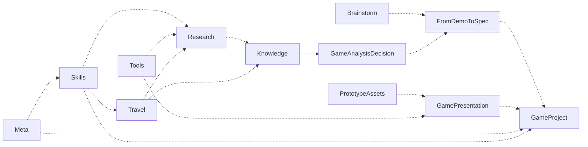

# AgentWorkSpace

[简体中文](README.md)

**Choose independent agent modules for your current task, and connect research, knowledge, travel and game development when needed.**

AWS 2.0 keeps meta and 11 functional modules in independent repositories, fixed by Git submodules. Each module owns its entry points, rules, licenses and release cycle. AWS provides discovery, compatibility review, installation, recovery and integration checks. Meta supplies an optional complete collaboration framework.

- Start with one module for one task.
- Extend an existing workspace after reviewing its framework and similar workflows.
- Use AWS for coordinated management, selected retrieval or an explicit all-module choice.

2.0.0 changes distribution and installation contracts. [Migration from 1.30.0](upgrades/2.0.0.md) · [Design and execution plan](docs/design/2.0.0.md) · [Release process](docs/release-process.md)

## Module cooperation panorama

The diagram presents major optional handoffs. Research supplies material, Knowledge preserves explicitly adopted content, and design/development modules consume evidence, recommendations and resources. The participating modules own concrete I/O, data ownership and integration conditions.

<!-- module-panorama:start -->


虚线表示可选协作。具体用途与接口见 module.json 和协作说明。 / Dashed edges indicate optional cooperation. See module.json and the cooperation guide.
<!-- module-panorama:end -->

| Independent module | Purpose | Integration |
|---|---|---|
| [Meta](https://github.com/ZhongTyler/AWS-Meta) | Optional workspace governance and recoverable collaboration. | Complete optional framework |
| [Brainstorm](https://github.com/ZhongTyler/AWS-Brainstorm) | Explore alternatives and retain proposals, decisions and recovery. | Standalone, optional peers |
| [FromDemoToSpec](https://github.com/ZhongTyler/AWS-FromDemoToSpec) | Develop playable prototypes and evidence-based production handoffs. | Standalone, optional peers |
| [Knowledge](https://github.com/ZhongTyler/AWS-Knowledge) | Query source-grounded material and maintain an owned knowledge library. | Standalone, optional peers |
| [Skills](https://github.com/ZhongTyler/AWS-Skills) | Select individual agent methods without enabling the whole library. | Standalone, optional peers |
| [GameAnalysisDecision](https://github.com/ZhongTyler/AWS-GameAnalysisDecision) | Analyze game evidence and conditional design decisions. | Standalone, optional peers |
| [GamePresentation](https://github.com/ZhongTyler/AWS-GamePresentation) | Prepare, review and integrate game presentation resources. | Standalone, optional peers |
| [PrototypeAssets](https://github.com/ZhongTyler/AWS-PrototypeAssets) | Find rights-reviewed resources and preserve source and license records. | Standalone, optional peers |
| [Travel](https://github.com/ZhongTyler/AWS-Travel) | Research, plan and render an owned trip as an offline website. | Standalone, optional peers |
| [Research](https://github.com/ZhongTyler/AWS-Research) | Collect sources and compile traceable studies and reader navigation. | Standalone, optional peers |
| [Tools](https://github.com/ZhongTyler/AWS-Tools) | Configure optional source, processing and local-model tools. | Standalone, optional peers |
| [GameProject](https://github.com/ZhongTyler/AWS-GameProject) | Create an owned Godot project with maintenance and resource atlases. | Standalone, optional peers |

Each module supplies its own baseline domain rules. Check tools and runtime for the actual feature. Review responsibility overlap, I/O, authority, data ownership and recovery before connecting similar modules. Discovery and dependency readiness establish preparation, while business interoperability needs its own review.

## Start selectively through AWS

Use the lightweight release ZIP or the shallow clone below. Audit reads metadata and relevant host material. Fetch retrieves selected modules. Installation retains preview, conflict refusal and transaction recovery. Full-history clones can still download large files retained in 1.x history.

```text
git clone --depth 1 https://github.com/ZhongTyler/AgentWorkSpace.git
cd AgentWorkSpace
python scripts/workspace.py audit --target <workspace> --packages travel research
python scripts/workspace.py fetch --packages travel research --apply
python scripts/workspace.py init --target <workspace> --mode compatible --packages travel research
python scripts/workspace.py init --target <workspace> --mode compatible --packages travel research --apply
```

Keep the distribution and recipient workspace separate. This example selects Travel and Research. Unselected modules remain absent. init --apply can retrieve missing selected sources and then recheck the recipient plan.

Full mode creates a new root framework and includes complete meta by default. Compatible mode installs only selected components and preserves host authority. Meta retains one complete edition, scoped under modules/meta for compatible integration. See [existing-workspace review](docs/compatible-workspace.md).

## Start from one module

For example, use Travel directly to create a synthetic trip. Core commands require Node.js 22+ and no npm runtime dependencies.

```text
git clone --depth 1 https://github.com/ZhongTyler/AWS-Travel.git
cd AWS-Travel
node scripts/make-demo.mjs --project ../my-trip
node scripts/travel.mjs build --project ../my-trip
node scripts/travel.mjs validate --project ../my-trip
```

Open my-trip/build/index.html. Real travel facts, prices, routes, bookings and weather need separate research and verification. Keep personal projects outside the module and continue through its README.

Review optional peers from the current independent repository, then retrieve them into sibling directories in the chosen workspace.

```text
python .module/module_manager.py audit --target <workspace> --modules research
python .module/module_manager.py fetch --target <workspace> --modules research --apply
```

The manager ships with each module and reads its local contract. A matching verified module can be reused. Owner edits or version differences require separate review. AWS registration of an existing independent instance records its actual location and preserves Git/file ownership.

## Explicitly select all modules

```text
python scripts/workspace.py fetch --all --apply
python scripts/workspace.py init --target <workspace> --mode compatible --all
python scripts/workspace.py init --target <workspace> --mode compatible --all --apply
```

Fetching all modules includes their tools and resources. Selected modules retain their baseline functionality. After installing Skills, select individual methods with scripts/skills.py. Module installation does not enable the entire method library. Tool downloads, models, services, accounts and scheduling follow feature-specific prerequisites and current authorization.

## Upgrade and recovery

Modules use independent semantic versions. AWS fixes a tested combination of module commits. A published module version has a fixed identity and inventory. Review the recipient diff and local conflicts after obtaining a newer AWS combination, then retain the transaction ID.

```text
python scripts/workspace.py upgrade --target <workspace>
python scripts/workspace.py upgrade --target <workspace> --apply
python scripts/workspace.py rollback --target <workspace> --transaction <id>
```

Add --apply after reviewing rollback. Client Skill upgrades and recovery use separate transactions. Project copies, Knowledge content, travel facts, accounts and runtime remain user-owned. See [2.0.0 migration and recovery](upgrades/2.0.0.md).

## Licensing and maintenance

AWS original material uses [MIT](LICENSE). Each module retains its license and third-party notices. Assets, fonts, tools and upstream methods follow their own terms. [Third-party notices](THIRD_PARTY_NOTICES.md)

Maintain and release module contents in the independent repository. AWS updates gitlinks, panoramas and integration verification. The old exporter retains historical use and refuses to replace 2.x submodules with legacy copies. Maintainers and agents start with [AGENTS](AGENTS.md) and the release process.

Engineering and synthetic checks describe their verified behavioral scope. Complete public end-to-end examples are still being developed. Research quality, art quality, human experience and long-term benefits require actual-task evaluation.
