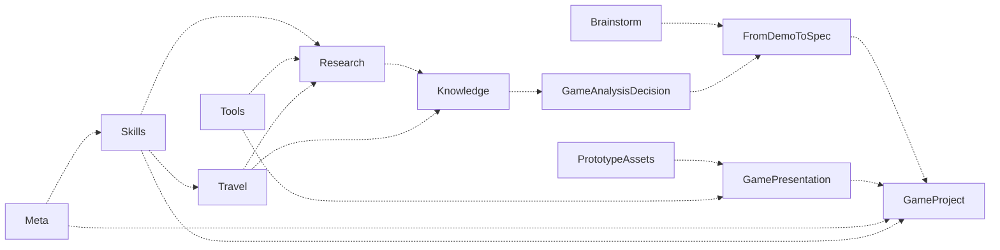

# AgentWorkSpace

[English](README.en.md)

**按当前任务选择独立 Agent 模块，让研究、知识、旅行与游戏开发按需协作。**

AWS 2.0 将 meta 和 11 个功能模块放在各自独立仓库，通过 Git submodule 固定版本。每个模块具有自己的使用入口、规则、许可和发布周期。AWS 提供全景、选择、兼容审阅、安装升级和组合验证。meta 是可选的完整协作框架。

- 只需要一个功能，可以直接从相应模块开始。
- 已有工作区，先审阅当前框架与同类工作流，再补充所需模块。
- 需要统一管理，使用 AWS 获取选定模块，也能明确选择全部获取。

2.1.0 更新五个模块，加入轻量 HTML 工程、独立资源工作台、研究依赖审计与有界调查入口。升级见 [2.1.0 升级与恢复](upgrades/2.1.0.md)。

2.0.0 改变了分发结构和安装合同。[1.30.0 迁移与恢复](upgrades/2.0.0.md) · [设计与执行方案](docs/design/2.0.0.md) · [发布流程](docs/release-process.md)

## 全模块协作全景

下图展示模块的主要可选协作方向。研究可提供材料，知识库保存经授权采用的内容，设计与开发模块接收事实、建议和资源。具体输入输出、数据 owner 和接线条件由相关模块维护。

<!-- module-panorama:start -->


虚线表示可选协作。具体用途与接口见 module.json 和协作说明。 / Dashed edges indicate optional cooperation. See module.json and the cooperation guide.
<!-- module-panorama:end -->

| 独立模块 | 用途 | 接入方式 |
|---|---|---|
| [Meta](https://github.com/ZhongTyler/AWS-Meta) | 可选的工作区治理、协作与恢复框架 | 完整框架，独立或局部接入 |
| [Brainstorm](https://github.com/ZhongTyler/AWS-Brainstorm) | 探索方案，记录候选、决定与讨论恢复 | 独立使用，可选接线 |
| [FromDemoToSpec](https://github.com/ZhongTyler/AWS-FromDemoToSpec) | 从可玩原型推进开发与正式交付 | 独立使用，可选接线 |
| [Knowledge](https://github.com/ZhongTyler/AWS-Knowledge) | 查询有来源的材料，维护自己的知识库 | 独立使用，可选接线 |
| [Skills](https://github.com/ZhongTyler/AWS-Skills) | 按任务选择开发、研究和表达方法 | 独立使用，可选接线 |
| [GameAnalysisDecision](https://github.com/ZhongTyler/AWS-GameAnalysisDecision) | 依据游戏证据分析问题、提出条件化建议 | 独立使用，可选接线 |
| [GamePresentation](https://github.com/ZhongTyler/AWS-GamePresentation) | 制作、审阅表现资源并接入游戏工程 | 独立使用，可选接线 |
| [PrototypeAssets](https://github.com/ZhongTyler/AWS-PrototypeAssets) | 选择原型素材，保留来源与许可记录 | 独立使用，可选接线 |
| [Travel](https://github.com/ZhongTyler/AWS-Travel) | 研究和规划旅行，生成私人离线网站 | 独立使用，可选接线 |
| [Research](https://github.com/ZhongTyler/AWS-Research) | 搜集材料，编译可追溯研究与阅读页面 | 独立使用，可选接线 |
| [Tools](https://github.com/ZhongTyler/AWS-Tools) | 按需配置来源、处理与本地模型工具 | 独立使用，可选接线 |
| [GameProject](https://github.com/ZhongTyler/AWS-GameProject) | 创建 Godot 项目工作区、维护流程与资源图册 | 独立使用，可选接线 |

所有模块的基础规则由本模块提供。外部工具与运行环境按实际功能检查。接入同类模块时，审阅职责、输入输出、权威、数据归属与恢复边界。模块目录可读或依赖满足，只说明发现与准备状态，具体业务接线仍需核对。

## 从 AWS 按需开始

轻量发布 ZIP 或下面的浅克隆先取得聚合入口。审计只读取目录和相关宿主材料。fetch 获取选择的模块，安装继续采用预览、冲突检测和事务恢复。完整历史克隆仍可能下载保留在 1.x 历史中的大文件。

```text
git clone --depth 1 https://github.com/ZhongTyler/AgentWorkSpace.git
cd AgentWorkSpace
python scripts/workspace.py audit --target <workspace> --packages travel research
python scripts/workspace.py fetch --packages travel research --apply
python scripts/workspace.py init --target <workspace> --mode compatible --packages travel research
python scripts/workspace.py init --target <workspace> --mode compatible --packages travel research --apply
```

目标工作区与发布仓使用不同目录。示例安装 Travel 与 Research，未选择的模块无需下载。init --apply 可以在需要时获取选中模块，然后重新核对目标计划。

新建完整根工作区可选择 full 模式，默认接入完整版 meta。兼容模式只安装所选内容，宿主根规则保持权威。meta 保持一个完整版，兼容接入时作为 modules/meta 中的局部补充。详见[已有工作区审阅](docs/compatible-workspace.md)。

## 从一个模块开始

例如直接使用 Travel 创建虚构样例。核心工作流需要 Node.js 22+，无 npm 运行依赖。

```text
git clone --depth 1 https://github.com/ZhongTyler/AWS-Travel.git
cd AWS-Travel
node scripts/make-demo.mjs --project ../my-trip
node scripts/travel.mjs build --project ../my-trip
node scripts/travel.mjs validate --project ../my-trip
```

打开 my-trip/build/index.html。真实旅行的事实、价格、路线、订单和天气需要单独研究与核对。自己的项目放在模块外，按模块 README 继续。

从当前独立仓扩展相关模块时，先审阅，再获取到指定工作区的平级目录。

```text
python .module/module_manager.py audit --target <workspace> --modules research
python .module/module_manager.py fetch --target <workspace> --modules research --apply
```

管理入口随模块交付，运行时读取本模块声明。已有同版本模块按身份和库存核对后复用，用户修改或版本差异进入单独审阅。已有独立实例加入 AWS 时登记其真实位置，保留原 Git 和文件所有权。

## 明确选择全部模块

```text
python scripts/workspace.py fetch --all --apply
python scripts/workspace.py init --target <workspace> --mode compatible --all
python scripts/workspace.py init --target <workspace> --mode compatible --all --apply
```

全部获取会下载各模块的工具和资源。只取需要的模块即可保留相应基础能力。Skills 安装后，再用其 scripts/skills.py 选择具体方法，不自动启用整个库。工具下载、模型、服务、账号连接和调度沿各模块条件与当前授权执行。

## 升级与恢复

模块独立使用语义版本，AWS 固定经过组合验证的模块提交。相同版本的模块身份与库存保持固定。更新 AWS 推荐组合后，预览目标升级与本地冲突，保留事务 ID。

```text
python scripts/workspace.py upgrade --target <workspace>
python scripts/workspace.py upgrade --target <workspace> --apply
python scripts/workspace.py rollback --target <workspace> --transaction <id>
```

回退预览确认后加 --apply。客户端 Skill 的更新和回退使用其单独事务。项目副本、知识正文、旅行事实、账号与运行环境由用户拥有。具体边界见[2.0.0 升级说明](upgrades/2.0.0.md)。

## 许可与维护

AWS 原创内容采用 [MIT](LICENSE)。每个独立模块携带自身许可及第三方通知，素材、字体、工具和上游方法按各自条款使用。[第三方内容说明](THIRD_PARTY_NOTICES.md)

模块内容在对应独立仓维护和发布，AWS 更新 gitlink、全景与组合验证。旧来源导出入口保留历史用途，2.x 聚合仓拒绝用旧副本覆盖子仓。维护者与 Agent 从 [AGENTS](AGENTS.md) 和发布流程定位当前合同。

工程与合成输入检查说明相应行为的已验证范围。公开的完整端到端使用案例仍在积累，研究质量、艺术质量、真人体验和长期收益由实际任务验证。
