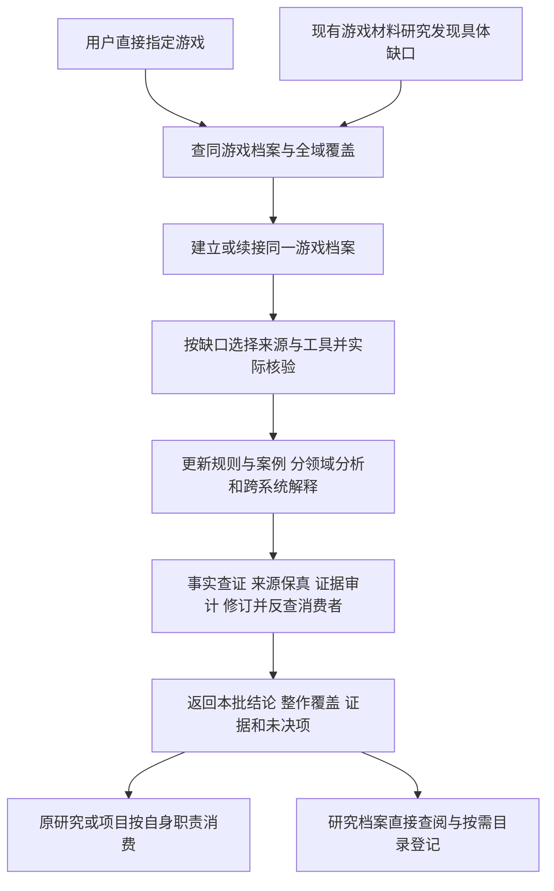

# 游戏深度拆解：输出、存放、复用与接线方案

> v1.4 单份HTML导航与关联交接 · 保留内容/目录/运行接口，研究产物作为直接查阅资料，不参与消化。原目标与漏项审查沿v1.2方法。范围/深度、事实保真、人读表达及工程/Git分别报告，目录或15域正文齐全都不构成完成证明。具体判据见verification.md。
> [执行入口](README.md) · [任务/证据模板](templates.md) · [游戏主报告模板](game-dossier-template.md)

## 1. 主要产物：一款游戏的研究档案

文字研究报告README.md及其units是完整研究内容的主本，study.json是同源编写底稿，HTML仅做人读呈现。新增或改进的讲解、过程、案例、对照和条件先同步文字，再派生HTML；不能以没有新事实为由只改HTML。纯控件／导航／样式可留在呈现层。具体维护与版本绑定沿[文字主本维护](../../.agents/skills/human-research-expression/references/reader-maintenance.md)。

文字档案统一为“整体总览／结论→领域与系统导航→完整章节／案例→条件与证据”。README是总入口：领域导航按本作有用的实际内容列出明确阅读顺序，并直接链接完整章节；不能只在HTML、manifest或后台覆盖账保留这条入口。较大游戏可将章节和案例分存systems/、cases/；轻量游戏可在README保留连续全文并按units/分节。两者共用一套研究正文，按体量选择物理层级，不强拆15个域、不重复维护领域版和文章版。HTML可沿理解顺序编排，同样能按领域找到对应完整内容。

全作与局部增量均沿[逐层拆解与成批研究](decomposition-and-batching.md)组织：整体→领域→子系统→对象／变体→具体规则，与机制、过程和系统联系共用唯一事实。详细拆解与问题主线是同一报告的两种阅读组织，不新增第二份人读报告；默认按子系统成批收尾，最终仍逐域及整篇核验。

默认目标是一份逐步完成的游戏研究档案，不是每轮单独产出一篇碎片文章。先全域盘点，再按证据和依赖分批深入；调用者指定重点只改变本批顺序，不把其他适用领域永久排除。局部问题可作为原档案的有界补充，报告本批回答程度和整作覆盖程度。

主报告优先让读者看懂有用研究，保持精简、清晰和高质量：讲清游戏怎样运作、为什么形成这些选择，以及使用结论所需的条件。不能只输出卡片、字段、评分或材料摘要。默认按以下顺序组织，长了才拆附件：

制作与修订先按当前内容选择单层、轻量分组或章→节，方法见[表达技能的目录层级规则](../../.agents/skills/human-research-expression/references/hierarchy.md#先选择目录层级)。将选择依据留在现有study或制作记录，再复用旧样式；验收核对主干、组内归属、阅读顺序和实际跳转。仅重排导航时直接复用已有分节、稳定锚点和正文，不为分组扩写内容。

内容单元制作前按[表达必要性与选型](../../.agents/skills/human-research-expression/references/expression-selection.md)检查当前文字／表图是否足以解释关系，再按理解任务选分镜、并列比较、标注画面、数量图、对象关系、状态条件、时间线或原始短片。沿用现有载体与导航，动态和交互按额外理解增量与制作维护成本选择；不规定图数、动画数或逐域必配形式。原讲解计划／study留必要的选型与证据，审计按同一标准反查遗漏与过度设计。

| 部分 | 应交付的实质内容 |
|---|---|
| 对象与阅读入口 | 游戏/代际、平台、版本、模式、角色与模组；本档案范围、结论摘要、实际体验/观察边界 |
| 整体设计 | 产品定位与核心体验，目标/核心动词、局内与局外循环、主要资源、信息与约束 |
| 阅读导航（按需） | 只列能帮助读者理解和选读的章节／领域；完整领域盘点放后台研究记录，不进入人读目录凑数 |
| 有用内容的拆解 | 围绕实际系统讲具体规则、操作、机制、案例、联系与使用条件；无阅读增量的整个领域可省略，共享内容合并讲解 |
| 跨系统模型 | 资源流、成长/构筑、状态变化、节奏与反馈如何互相影响；避免各领域各说一遍而不连接 |
| 关键情境 | 正常、失败、边界/替代选择等能改变判断的真实案例；前态→可选动作→实际动作→反馈→后态 |
| 评价与迁移 | 支持何种判断、代价和替代解释；可迁移机制/配方及不宜照搬处，个人感受、开发者意图与实证效果分开 |
| 可复用结论索引 | 每条稳定结论ID、适用条件、版本、反例、证据ID、原章节；供后续研究/项目准确引用 |
| 缺口、版本与继续研究 | 当前覆盖、待补材料、恢复入口、失效结论、实际调用与成本；没有获得的证据明确留空 |
| 内容验证 | 本批事实查证、来源保真、证据审计的实际范围、发现、修订、未决和自审/独立审计性质；短记录并入缺口或原validation，不另建平行报告 |

“分领域拆解”每节至少能回答：有什么、怎样运行、玩家具体怎么操作/看见什么、如何形成取舍、与其他系统怎样作用、证据在哪里、在哪些条件下判断会变。并非每节强制同一表格或字数；属于制作过程/工程实现的内容需要公开源码、开发者资料等对应证据，不能从画面臆测。

## 2. 全领域覆盖怎样落实

每次开题从已配置Knowledge或等效导航取得基线并记版本；缺少模块时根据实际研究目标冻结本地领域基线，不永久固化为“六大领域”或本次15域快照。现有域内有相关内容就拆；艺术风格、动画、镜头、可访问性、联机/社交等若有实际内容而现有域划分不足，可新增本次研究维度并映射现有域，不擅自创建/改名 Knowledge 域。

每域分别记录：
- **适用性**：存在相关对象 / 有依据不适用 / 尚待核查。资料未找到不是“不存在”。
- **覆盖**：未开始 / 只读规则或资料 / 已观察具体内容 / 已形成机制分析 / 已反查；标明实际覆盖的子系统和阶段，不能只用一个“已完成”遮蔽范围。
- **证据**：原始来源、实际读到的内容、版本、代表案例及关键缺口。
- **后续**：存在但未完成的内容保持待补，下一批从原档案继续。

制作/元领域也要逐项判断，例如运营、工程、项目管理、设计方法、开发者成长、AI开发实践；有对应研究对象和材料就分析，无公开资料则明确未知，不能编造其团队过程，也不能把研究者自己的心得当作该游戏的事实。

全域表用于后台查漏，研究覆盖与读者展示分开。重要系统仍按原目标研究；资料未知、纯标签或没有阅读增量的领域不占读者目录和正文。分批可以交付有用阶段报告，始终同时说明本批完成了什么、整作还缺什么。

## 3. 放在哪里

游戏深度研究正式成果存放在接收方指定的包外目录；以下Knowledge布局在接收方启用该模块时使用。Research 保留研究方法、批次过程、冻结收据和构建工具；不再保存第二套可演进的正式报告。没有相应材料就不建空目录和空文件。

```text
Knowledge/
  research-reports/
    README.md                         接收方已接受报告的统一入口
    catalog.json                      本机接受版本与稳定查询身份
    <game-id>/
      README.md                       这款游戏的唯一主报告/恢复入口
      manifest.json                   当前完整文稿与必要证据清单
      reader/index.html               一份自包含人读报告
      reader/navigation.json          本作领域路线与正文对应元数据
      evidence/                       必要证据原件与冻结领域快照
      evidence.md                     来源、规则、情境和结论映射
      systems/<system-id>.md           长篇系统/领域附件
      cases/<case-id>.md               有独立体量的真实情境
Research/
  game-research/deep-game-analysis/     方法、调用合同和模板
  experiments/game-studies/<game-id>/<batch-id>/
    manifest.json                     原材料身份、路径、哈希、实读范围、来源/版本
    media/                            必要截图、少量合法关键片段/音频
    transcripts/                      原字幕与对齐文字，标清来源及是否实际核验
    outputs/                          OCR/抽帧/计算等派生结果
    receipts/                         实际工具版本、命令/退出码、失败与成本
```

默认先维护一个主报告和一个批次证据清单。规则账/状态账少时直接作附录；明显过长才拆 evidence.md。不要每个领域先建空文件，也不为不同调用者复制整份报告。

Research 负责研究与内容查证，Knowledge owner 按维护流程管理正式存储、接受版本、路径与查阅接线。报告正文或证据更新后，先核原研究检查，再接受当前manifest；不把新字节沿用为旧批准。旧Research正式路径只保留迁移入口，冻结批次清单不回写。正式读取必须能在报告包内取得声明文稿与必要证据，可选的研究过程追溯可返回Research；直接查阅和Ingest继续解耦。

大视频、长录屏、大源码、依赖与缓存留本机被忽略的 runtime 或原合法文件位置，manifest记原链、路径、精确版本/哈希及恢复方式。创建 runtime 前先明确忽略规则并验证实际生效；“目录叫 runtime”本身不能保证不入 Git。下载、备份、迁机恢复与许可沿原授权，不批量拉取视频或私人游戏库。固定游戏源码继续留 reference-library，不复制进每个档案。

同游戏的平台/版本不同先在同一档案标明适用范围和冲突；只有实质分叉且难以共同阅读时才拆版本附件。更新保留旧结论的适用版本/替代关系，不能把新版数值回写成旧录像中的事实。报告可演进，原材料及被冻结的实验输出保留原字节。

**原《杀戮尖塔》事件样例**仍是 experiments/game-deep-research-20261025 中的 partial 证据，不迁移、重算或升级它的状态。v0.3主档案已链接该证据，新普通战斗/资料放新批次；保留原case_id和来源链，整作系统层档案与单个情境partial可以同时成立。

单份HTML的目录/领域双入口、悬浮/并排、源分节绑定和分层核验沿[导航制作](reader-navigation/README.md)。正式报告不再把另一份HTML/源码当常规阅读必经页；采用后的旧样例回到唯一入口。

## 4. 怎样利用，避免只留下文档

| 使用场景 | 读取/返回什么 | 谁拥有最终状态 |
|---|---|---|
| 用户学习一款游戏 | 主报告的整体模型、适用领域章节、带画面/规则的案例；必要时可视化讲解 | Research拥有研究结论，理解/体验效果不靠自评确认 |
| 后续材料研究 | 先查档案结论索引；新文章只补新版本、反例、边界或未覆盖内容 | 原材料研究报告记录实际消费与增量 |
| 游戏项目的设计/开发 | 返回特定结论、机制条件、代价、案例证据和验证建议，链接原档案 | 项目/GAD按自己的职责做决定和验证，不由Research直接改DEC/规格 |
| Knowledge直接查阅 | 原档案位于Knowledge；Research维护研究内容，主动交可用关系，不再整份转换Raw/Wiki | 已实施的可选研究档案Module；目录由原owner显式接受版本，不接writer、Ingest或Raw计数 |
| 专题 | 仅预留将来读取档案的可能性 | 当前暂缓，专题真实落地时再设计，不创建专题或引用任务 |

每条可复用结论采用稳定ID（例如 C-012），指向报告原章节与证据ID（S来源、R规则、E情境）。调用者记录“用了哪条、影响什么、结果未知/有效/反例”，原档案负责纠错与版本边界。游戏实测和项目采用分别保存，避免“被引用”被记成“已经证明有效”。

这些ID和索引在Markdown/manifest内维护，不另建数据库。Knowledge已实施可选研究档案查阅Module，可沿原Query按需发现、读取和验证接受版本；本包从空目录开始，报告由接收方明确接受；当前清单以Knowledge目录为准。未登记档案仍可直接读取，不能声称已由目录发现或自动接受新版本。研究完成/更新后按[研究交接](knowledge-handoff.md)评估完整报告的关联覆盖、明确未关联理由后主动提交提案，由Knowledge owner统一更新Wiki/Group及接受目录；三种查阅路径与有界展开验证一并接回。研究来源保持独立类型，不冒充Wiki/Raw或“已消化”；具体入口见本机查阅合同（沿接收方维护入口）。

## 5. 原有 tools 怎样辅助

继续使用现有 game-research 宿主及工具身份，不注册一套重复服务。下表是可执行选路方案，**“原工具有能力”与“新流程已经实际调用验证”分开**；本次已用与尚未调用的能力见表后v0.3实测补充，不合称所有工具全链路通过。

| 环节/工具 | 输入 → 辅助输出 | 在本流程里的用途与回退 |
|---|---|---|
| Knowledge Query/复利出口 | 游戏/机制问题 → 既有知识、版本与消费记录 | 查重、建立假设和领域基线；实读正文后消费，不以检索命中算核验。不可用时保留缺口继续原来源 |
| 来源MCP/公开网页/官方资料 | 合法公开问题或指定链接 → 选定正文、版本说明/开发者复盘 | 找一手规则与制作事实；不外发内部材料，不增加订阅、账号或采集任务 |
| 宿主浏览器/原生字幕 | 原视频/动态页面 → 实际画面、可得字幕、读取区间 | 核对UI、操作、声音及实际前后状态；超时/缺字幕只阻断相关证据，不能用封面/OCR补成过程 |
| Tools media/capture.py | 公开正文与唯一容器 → HTML、正文、原图、元数据/哈希 | 保存图文规则和访谈底本；动态内容回浏览器。工具不负责判断机制 |
| Tools media/ocr.py | 选定图片/GIF → 文字框、转录候选、帧位置 | 辅助读卡牌、UI、表格和查找；原图保留，关键规则/数字实际读图复核 |
| 既有 FFmpeg | 已合法取得本地媒体 → 带时点的片段、帧/音轨 | 针对具体动作补中间过程和对齐；不会自动取到任意在线媒体，抽帧不等于完整观看 |
| reference-library | 已保存固定版本及目标模块 → 校验后的源码定位 | 有源码时解释实现；不全库扫描，不把其他游戏代码当本游戏事实，不自动运行上游代码 |
| REA | 明确需要发行产物的具体问题 → 静态实现证据 | 只有源码不足且产物属于已授权范围才调用；当前能力有边界，不默认扫描安装目录/存档 |
| 本地计算/图表 | 已核实规则和输入 → 资源/数值/状态推演 | 辅助复算阈值、组合与反例；推演不是实际玩家数据，模型和输入写清楚 |
| Anatomy/轻量图解 | 已有机制模型 → 说明图或交互演示 | 当前经 research/explanation 原路按需使用；game-research 工具白名单未含 Anatomy，未验证前不称已接入该宿主。文字/简图够用就不制作演示 |
| 原决策模型 | 有明确收益的批量语义分类 → 初步整理 | 仍按原政策选择/跳过；不承担完整摘要、画面事实或因果结论，不为新流程自动加模型 |
| BORIS等候选 | 真正出现长视频标注瓶颈时再评估 | 本轮未安装/集成；默认先用已有浏览器/本地媒体工具 |

维护源：Tools（沿接收方维护入口）、媒体（沿接收方维护入口）、[源码参考库](../../reference-library/README.md)、工具接入合同（沿接收方维护入口）。本表不扩大工具白名单、发布、费用或数据访问权限；新接线沿真实输入→工具→复核→报告消费及失败回退验证后，才更新其采用状态。

v0.3实测补充：Query/复利出口、公开网页/GitHub、浏览器字幕与已解码帧、media.capture的官方FAQ、RapidOCR CPU和本地计算均有实际输出被消费。商店capture曾TLS超时，FAQ回退成功；OCR数字错误回原图。具体见首例验收。表中FFmpeg/REA/BORIS/Anatomy/额外模型仍是按需路线，不能合称已全链路集成。

## 6. 嵌入现有流程的具体位置



- 默认的独立深拆走全游戏档案路线。材料研究只需一项证据时，可调用 focused_extension；它补到同一档案并返回本次问题，不偷偷把全作目标缩成一个片段。
- 现有 controller/adapter 材料包仍由原合同拥有；子研究返回 report/case/claim/evidence 引用，不改旧包指纹、研究配额和计数，不因档案多一次更新就新增一轮。
- 当普通日检预算不足以完成深拆时返回待续/排队，保存原owner和覆盖停点；用户直接委托的深拆按该授权推进。调用不提前恢复暂停日检，也不补跑暂停期。
- 当前是人工研究协议、业务校验/返回及便携交付接线，不宣称已构建自动视频观看器、全域检索服务或一键研究程序。专题接入暂缓，本轮不做专题导读、案例对读、页面或调度。

## 7. 落地与验收顺序

1. 全域目标、目录与调用合同沿v0.2保留；v0.3在首例主档案（沿接收方维护入口）执行，15域逐项有实质正文，额外维度单列。
2. 普通战斗关键帧支持前后状态闭合；实际点击/反击瞬间未连续见到，保持规则支持的重建，旧事件仍partial。不能将其升级为完整连续观影/亲玩。
3. 原方法研究以构造问题演示C03/C04/C07返回；真实C10材料复查仍partial/no_increment；业务校验覆盖错误作品/版本、媒体/哈希、缺域与不可用来源等失败，便携交付单独核对。语义反查和证据深度仍由研究者负责，工程PASS不替代它们。
4. 所有适用域都需有实质内容和对应证据，主要系统/角色/阶段的证据深度须与原目标匹配。全部已知适用条目及关键变体均需逐项交代，可继承共享规则并说明差异；不要求每项重复实测、全装备组合实验或范围外平台逐一验证。阶段不足保持partial，不在交付时改称“系统层完整”来关闭原目标。
5. 批量处理、自动化辅助或工具新增只在真实瓶颈出现后补；每次保留实际收益/失败/维护成本。当前不加调度、入库或网站任务。
6. 每批研究者自行执行[内容查证与审计](verification.md)，使用适用且可用的source-fidelity/evidence-audit，缺Skill就披露并就地反查；必要证据缺失仍保留状态。独立审计任务可补强，但不作为默认依赖。内容状态写在原验证节和实际返回边界，现有机器JSON不新增自动语义PASS，历史档案和包不为补字段改哈希。

审计补证已实际使用既有FFmpeg，见E05/E06与补证收据；上表其余按需路线未因这次调用变成已集成。
